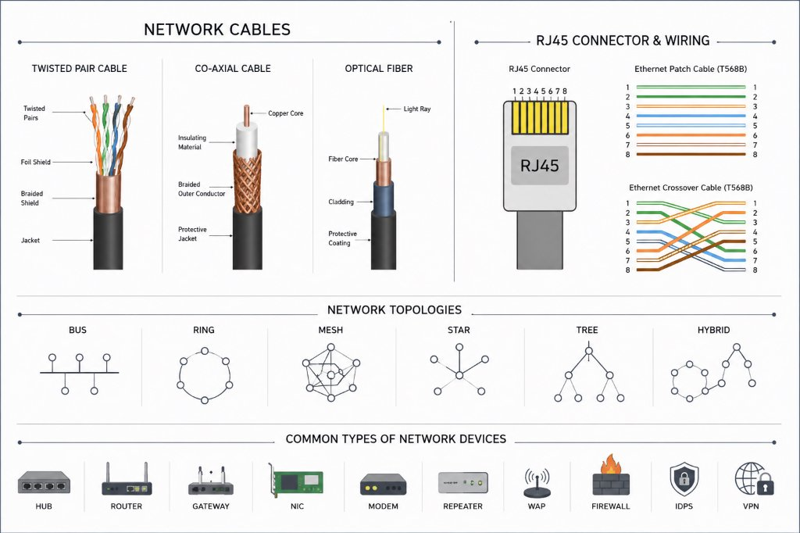

# Practical 1: Study of Basic Hardware Components and Networking

**Name:** Harsh Bhongade  
**PRN:** 24070521080  

---

## 1. Overview Diagram

---

## 2. Network Cables (Transmission Media)

### 1. Twisted Pair Cable
* **Construction:** Pairs of color-coded copper wires twisted around each other (typically 4 pairs) protected by foil shielding, braided shielding, and an outer PVC jacket.
* **Working Principle:** Twisting copper wires cancels out electromagnetic interference (EMI) and radio frequency interference (RFI) from neighboring pairs (cross-talk).
* **Standards:** Cat 5e, Cat 6, Cat 6a, Cat 7 (supports bandwidths from 100 Mbps to 10 Gbps).
* **Connector:** RJ45 connector.

### 2. Co-Axial Cable
* **Construction:** Consists of a central solid copper core, surrounded by a dielectric insulating material, a braided metallic outer conductor (which acts as a shield and ground), and a protective outer jacket.
* **Characteristics:** Higher bandwidth than standard unshielded twisted pair; traditionally used in cable television (CATV), broadband internet, and legacy Ethernet (10BASE2 Thinnet, 10BASE5 Thicknet).
* **Connector:** BNC (Bayonet Neill-Concelman) / F-type connector.

### 3. Optical Fiber Cable
* **Construction:** Composed of an inner glass or silica core, surrounding glass cladding (with a lower refractive index), and protective buffer coating/jacketing.
* **Working Principle:** Transmits binary data as high-speed pulses of light using the physical phenomenon of **Total Internal Reflection (TIR)**.
* **Advantages:** Exceptionally high bandwidth, extremely low signal attenuation over long distances, and 100% immune to electrical/electromagnetic interference.
* **Types:** Single-Mode Fiber (SMF - long range, laser light source) and Multi-Mode Fiber (MMF - shorter distances, LED light source).

---

## 3. RJ45 Connector & Wiring Schemes

### 1. RJ45 Connector (Registered Jack 45)
* An 8-position, 8-contact (8P8C) standardized modular connector used for terminating twisted-pair Ethernet cables.
* Pins are numbered from 1 to 8 (from left to right when viewed with the locking clip facing away).

### 2. Ethernet Patch Cable (Straight-Through - T568B to T568B)
* Both ends of the cable use the identical T568B pinout standard:
  * **Pin 1:** White / Orange
  * **Pin 2:** Orange
  * **Pin 3:** White / Green
  * **Pin 4:** Blue
  * **Pin 5:** White / Blue
  * **Pin 6:** Green
  * **Pin 7:** White / Brown
  * **Pin 8:** Brown
* **Use Case:** Connecting unlike devices (e.g., Computer to Switch, Switch to Router).

### 3. Ethernet Crossover Cable (T568A to T568B)
* Pins 1 & 3 and Pins 2 & 6 are swapped between the two cable ends:
  * Pin 1 (Tx+) connects to Pin 3 (Rx+)
  * Pin 2 (Tx-) connects to Pin 6 (Rx-)
  * Pin 3 (Rx+) connects to Pin 1 (Tx+)
  * Pin 6 (Rx-) connects to Pin 2 (Tx-)
* **Use Case:** Connecting similar devices directly without an intermediary switch (e.g., PC to PC, Switch to Switch).

---

## 4. Network Topologies

1. **Bus Topology:**
   * All devices share a single linear central backbone communication cable.
   * Both ends of the cable require 50-ohm terminators to absorb signal reflections.
   * High collision probability; if the backbone cable breaks, the entire network fails.

2. **Ring Topology:**
   * Each workstation is connected to two adjacent neighbors, forming an unbroken circular loop.
   * Data packets travel unidirectionally (or bidirectionally in dual-ring setups) using a token passing mechanism.

3. **Mesh Topology:**
   * Every node is directly interconnected with dedicated point-to-point physical links ($N(N-1)/2$ links for $N$ nodes in full mesh).
   * Provides maximum fault tolerance and redundancy; a failure of any single link does not disrupt communication.

4. **Star Topology:**
   * Every host connects directly to a central networking device (Switch or Hub) via dedicated point-to-point links.
   * Most common modern LAN topology; single device cable failures do not bring down the network.

5. **Tree Topology (Hierarchical):**
   * Combines elements of star and bus topologies structured into a parent-child hierarchical branching structure.
   * Facilitates scalable expansion for large corporate or university networks.

6. **Hybrid Topology:**
   * A combination of two or more distinct topologies (e.g., Star-Ring, Star-Bus) designed according to institutional requirements.

---

## 5. Common Types of Network Devices

1. **Hub:**
   * A Layer 1 (Physical Layer) device that receives data frames on one port and blindly broadcasts them to all other connected ports. Single collision domain.

2. **Router:**
   * A Layer 3 (Network Layer) device that routes data packets between distinct logical IP subnets using routing tables and protocols (RIP, OSPF, BGP).

3. **Gateway:**
   * Operates across Layers 3 to 7; acts as a protocol translator allowing communication between networks running dissimilar networking architectures.

4. **NIC (Network Interface Card):**
   * Layer 2 hardware component that provides physical and data link connectivity to the network, programmed with a factory-burned 48-bit MAC address.

5. **Modem (Modulator-Demodulator):**
   * Converts digital data from a computer into analog signals for transmission over telephone/cable lines, and demodulates incoming analog signals back into digital data.

6. **Repeater:**
   * Layer 1 electronic signal regenerator that amplifies attenuated signals to overcome cable distance limitations.

7. **WAP (Wireless Access Point):**
   * Connects wireless Wi-Fi devices (IEEE 802.11) to a wired Ethernet backbone network.

8. **Firewall:**
   * Hardware or software security device that monitors and filters incoming and outgoing traffic based on predefined security rules and access control lists (ACLs).

9. **IDPS (Intrusion Detection & Prevention System):**
   * Real-time network monitor that detects malicious traffic, anomalies, and policy violations, actively blocking unauthorized or suspicious packets.

10. **VPN (Virtual Private Network):**
    * Creates an encrypted, secure virtual tunnel over an untrusted public network (Internet) to protect data confidentiality and integrity.
